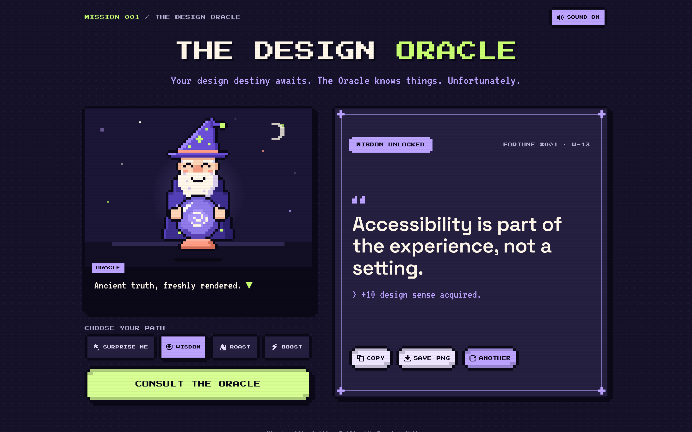

# Mission 001: The Design Oracle

**Date:** 2026-11-23
**Tech:** React 19 · TypeScript · Vite · Tailwind CSS v4 · [8bitcn](https://www.8bitcn.com/)

> *Your design destiny awaits. The Oracle knows things. Unfortunately.*



## 🎯 The mission

Build a small, working app with a strong 8-bit style using the 8bitcn UI library.
I picked the **random quote generator** and turned it into a pixel fortune teller for designers.

## 🛠️ What I built

An arcade fortune-telling machine starring a pixel wizard who has spent far too long around Figma files and stakeholders.

- **Three kinds of fortunes:** 🔮 **Wisdom** (design truths), 🔥 **Roast** (gentle burns), ⚡ **Boost** (go make something). **Surprise Me** mixes all three.
- **45 original fortunes**, 15 per category.
- **No repeats:** a shuffle bag goes through every quote before reshuffling, and never shows the same quote twice in a row.
- **A pixel-art Oracle** drawn in SVG with 5 expressions: idle (floating and blinking), thinking, wise smile, smug side-eye for roasts, and star-eyed for boosts.
- **The reveal:** the crystal ball shakes and swirls, pixel particles burst out, and the quote types itself onto a collectible fortune card. It all takes about 1.2 seconds.
- **Copy quote** to the clipboard, with a fallback if the clipboard is blocked.
- **Save card as PNG:** a 1080×1080 share image drawn on a canvas, with the Oracle on it.
- **Optional 8-bit sound** made from scratch with the Web Audio API. It's off by default.
- **Accessibility:** works with a keyboard, has visible focus rings, announces each fortune to screen readers, and respects *reduced motion* (the fortune appears instantly).
- Works on desktop and on phones down to 375px wide.


### 8bitcn components used

| Component | Where |
|---|---|
| `Button` | Consult the Oracle, Copy, Save PNG, Another |
| `Card` | The arcade stage and the fortune card |
| `Badge` | Category label on the fortune card |
| `ToggleGroup` | Surprise Me / Wisdom / Roast / Boost picker |
| `Toggle` | Sound on/off |
| `toast` | "Fortune copied" and "Card saved" messages |

The components live in `src/components/ui/8bit/`, with the shadcn base components they wrap in `src/components/ui/`.
`components.json` registers the `@8bitcn` registry, so you can add more components with:

```bash
pnpm dlx shadcn@latest add @8bitcn/<component>
```

## ▶️ How to run it

```bash
cd mission-001-design-oracle
pnpm install
pnpm dev
```

Then open http://localhost:5173.

Other scripts: `pnpm build` (type-check and production build), `pnpm lint`, `pnpm test` (shuffle-bag unit tests).

## 🗂️ Where things are

```
src/
├── App.tsx                      # page layout + reveal state machine
├── data/fortunes.ts             # all 45 fortunes + category labels, reactions, dialogue
├── lib/
│   ├── pixel-art.ts             # Oracle, crystal ball and icons as pixel grids
│   ├── shuffle-bag.ts           # no-repeat randomiser
│   ├── export-card.ts           # 1080×1080 PNG renderer
│   ├── sound.ts                 # Web Audio chimes
│   └── clipboard.ts             # copy with fallback
└── components/
    ├── oracle/                  # stage, fortune card, category picker, sprites
    └── ui/8bit/                 # 8bitcn components
```

## 💡 What I learned

- Drawing pixel art as data (a grid of coloured cells) means one drawing can power both the live SVG and the exported PNG.
- A shuffle bag makes random feel *fair*: people notice repeats much more than true randomness.
- Timing is a design material. A 0.7s "thinking" beat before the reveal makes the result feel earned without feeling slow.

## 📝 Notes

- The cloud environment I built this in couldn't reach 8bitcn.com, so the components were copied from 8bitcn's official GitHub repo ([TheOrcDev/8bitcn-ui](https://github.com/TheOrcDev/8bitcn-ui)). That is the same thing `shadcn add` does. Two small changes: removed one unused import in `toast.tsx`, and removed the Google Fonts `@import` from `retro.css` because the fonts are bundled locally with Fontsource.
- All fortunes are original. None are attributed to real people.

## 📣 Posts

- LinkedIn:
- X:
