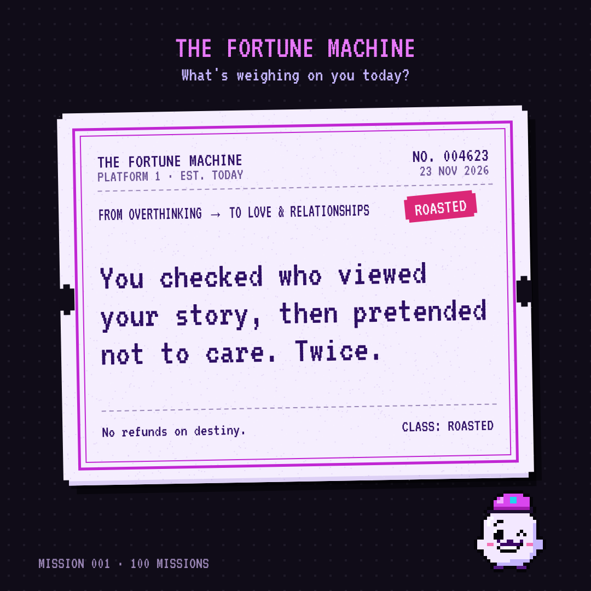

# Mission 001: The Fortune Machine

**Date:** 2026-11-23
**Live:** https://100-missions.vercel.app/mission-001/
**Tech:** React 19 · TypeScript · Vite · Tailwind CSS v4 · [8bitcn](https://www.8bitcn.com/) · Web Audio API

> *What's weighing on you today?*
> *Insert a coin. The universe has opinions.*


## 🎯 The mission

Build a small, working app with a strong 8-bit style using the 8bitcn UI library.

V1 was "The Design Oracle", a quote generator for designers. V2 turns it into **The Fortune Machine**, inspired by the coin-operated weighing machines on Indian railway platforms, dressed in 8bitcn's **VHS theme**. You step up, drop a coin, the wheel spins, the machine whirs, and out comes a printed ticket. It doesn't weigh you. It weighs what's on your mind.

## 🛠️ What I built

- **The machine:** an original pixel-art railway machine drawn as SVG pixel geometry. It has an octagonal head with a ring of chasing bulbs, an illuminated fortune wheel, a name sign, a ₹1 coin slot, a gauge with a moving needle, status lamps, a ticket dispenser and a weighing platform with footprints.
- **Tikku, the fortune-keeper:** a tiny lavender creature in a fuchsia railway cap and handlebar mustache, living in the machine's window. One base sprite with 13 animation frames:
  - **Idle:** breathes, blinks, glances around and occasionally looks smug.
  - **Coin received:** jumps with a "!" and turns to the mechanism.
  - **Calculating:** squeezes his eyes shut and pulls a tiny lever. The bulbs flash in time and he breaks a sweat.
  - **Delivered:** a sly wink for a Roast, a knowing look for Wisdom, star eyes and waving arms for Hype.
- **The ritual, in about two seconds:** the coin flies into the slot, the machine wakes up, the wheel spins, the printer clicks, and a ticket prints out of the dispenser and lands in front of you.
- **Collectible tickets:** lavender paper with grain, a double fuchsia frame, perforated notches, a ticket number, a "From Overthinking → To Work & Ambition" route, a rubber stamp for the fortune type and readable typewriter text.
- **81 original fortunes,** for everyone, not just designers: 3 topics × 3 tones × 9 each. They're drawn without repeats until a pool runs out, and never the same one twice in a row.
- **Sound design:** six original Web Audio effects (coin, activation, wheel spin, printer, reveal chime and button click) through one quiet master bus. Sound is on by default and starts with your first click or tap (browsers block audio before that). The toggle at the top mutes it.
- **Copy fortune** and **save ticket as a 1080×1080 PNG**.
- **Pixel confetti** for Hype fortunes.
- **Accessibility:** keyboard focus rings and screen-reader announcements. With *reduced motion* on, the ticket appears instantly with no animations.
- **Layouts:** responsive from 390px phones to large desktops. The machine art always snaps to whole device pixels, so it stays crisp.



### Theme: 8bitcn "VHS"

The whole app uses the dark variant of 8bitcn's [VHS theme](https://www.8bitcn.com/themes?theme=vhs). The colours were converted from the theme's oklch values to hex:

- **Background:** `#100c18`
- **Card:** `#181123`
- **Text:** lavender `#e9d5ff`
- **Primary:** fuchsia `#d946ef`
- **Secondary:** violet `#a855f7`
- **Ring and glow:** cyan `#0ea5e9`
- **Accents:** teal and pink

**Type and spacing** also follow the theme: VT323 for every font, 0.05rem letter spacing, a 0.25rem spacing scale and a soft cyan glow. The title adds a VHS colour-split.

### 8bitcn components used

| Component | Where |
|---|---|
| `ToggleGroup` | "What's weighing on you?" and "Choose your fortune" selectors |
| `Button` | Insert Coin, Another Fortune, Copy, Save PNG |
| `Toggle` | Sound on/off |
| `Badge` | The rubber stamp on each ticket |
| `toast` | Copy and save confirmations |

The machine and Tikku are custom pixel art. 8bitcn provides the controls.

## ▶️ How to run it

```bash
cd mission-001-design-oracle
pnpm install
pnpm dev
```

Open http://localhost:5173.

Other scripts: `pnpm build`, `pnpm lint`, `pnpm test` (shuffle-bag unit tests).

## 🗂️ Where things are

```
src/
├── App.tsx                          # layout + the coin → wheel → printer → ticket choreography
├── data/fortunes.ts                 # 81 fortunes, topics, tones, Tikku's lines
├── lib/
│   ├── art/machine.ts               # the machine: static body + animated bulbs, wheel, gauge, lamps, lever
│   ├── art/tikku.ts                 # Tikku's sprite and expressions
│   ├── art/icons.ts                 # 8×8 panel icons
│   ├── pixel/grid.ts, font.ts       # tiny pixel-art toolkit and a 3×5 pixel font
│   ├── sound.ts                     # Web Audio sound effects
│   ├── export-ticket.ts             # 1080×1080 PNG renderer
│   └── shuffle-bag.ts               # no-repeat randomiser
└── components/
    ├── machine/                     # machine, control panel, ticket, coin
    └── ui/8bit/                     # 8bitcn components
```

## 💡 What I learned

- A ritual beats a result. The same random quote feels far more special when you have to drop a coin and wait for it to print.
- Pixel art needs whole-pixel scaling. Drawing at a non-whole scale leaves faint seams, so the machine's size snaps to whole device pixels.
- A character comes alive from reactions, not motion. Tikku barely moves, but he notices the coin, works the lever and reacts to what he printed.

## 📝 Notes

- The theme values were read from 8bitcn's source (`app/retro-globals.css`, `.theme-vhs`).
- The 8bitcn components were copied from 8bitcn's official GitHub repo, because the cloud environment couldn't reach 8bitcn.com. That's the same thing `shadcn add` does. Two small changes: removed one unused import in `toast.tsx`, and removed the Google Fonts `@import` from `retro.css` because fonts are bundled locally.
- All fortunes are original. None are attributed to real people.

## 📣 Posts

- LinkedIn:
- X:
