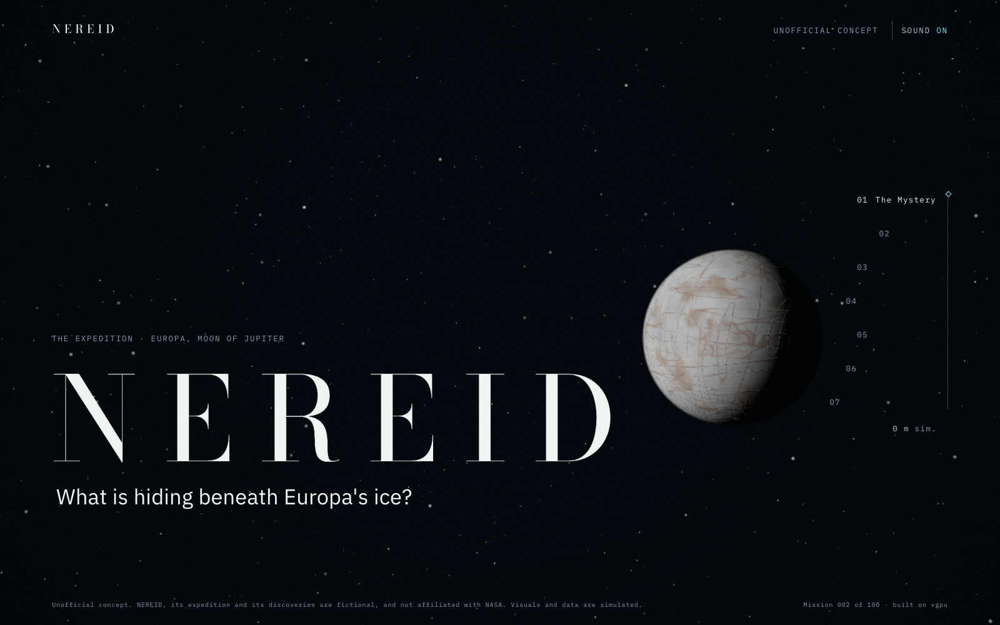

# Mission 002: NEREID

**Date:** 2026-11-24
**Live:** https://100-missions.vercel.app/mission-002/
**Tech:** TypeScript, Vite, WebGPU (vgpu), WGSL, Web Audio, ElevenLabs sound effects



## 🎯 The mission

A scroll-driven expedition to Europa, Jupiter's ice moon. A probe melts through the ice, finds the ocean beneath, follows a warm signal to a hydrothermal vent, and sends its findings home. The expedition and its discoveries are fictional; the science behind them is real.

## 🛠️ What I built

- Seven chapters that follow the scroll: space, the descent through 20 km of ice, the ocean, the sonar scan, the vent, the transmission.
- One WebGPU renderer with three worlds (space, ice shaft, ocean). A pure "director" turns the scroll position into camera, light and the blend between worlds.
- The ocean is the vgpu FFT ocean example, extended with a scroll-driven sonar pulse that reveals the sea floor and a thermal anomaly.
- Text that reads at a human pace: one thing at a time. Callout sentences come up word by word, and instrument lines type out like a teleprinter, with a tick per letter.
- Sound: three ambient beds that crossfade with the scene and open up as you move, plus cues on the story's events. Everything was generated with ElevenLabs, auditioned, measured and levelled.
- Quality tiers that lower render resolution only when it actually helps the frame rate. A still image per chapter where WebGPU isn't available. A reduced-motion version.

## ▶️ How to run it

```bash
cd mission-002-nereid
pnpm install
pnpm dev     # opens Chrome at http://localhost:5173
pnpm test
```

WebGPU needs a recent Chrome, Edge or Safari. Other browsers get the still images.

## 🗂️ Where things are

```
index.html            the seven chapters, their copy and timing windows
src/main.ts           scroll → story → director → renderer, and the text overlay
src/lib/director.ts   scroll position → cameras, world blend, flashes (tested)
src/lib/story.ts      spring-smoothed scroll and the sonar sweep (tested)
src/lib/mix.ts        sound mixing rules (tested)
src/sound.ts          Web Audio engine
src/type/             kinetic type and callout layout and reading pace (tested)
src/ocean/            WGSL shaders and the render graph
public/sound/         the sound effects
copy.md               the copy, chapter by chapter
```

## 💡 What I learned

- Pace the text in units of scroll, not chapter percentages. A rule like "4vh plus 0.9vh per word" stays readable when a chapter gets longer.
- An automated audit of when each text element forms (10 % to 90 % visible) against the story position finds every overlap in one run.
- Browsers allow no sound before a click, and scrolling doesn't count. Plan the opening around that.
- Generated ambience mixed for headphones disappears on laptop speakers. Measure the actual output level, and keep some top end.
- Generated sound effects need measuring before use: silent lead-ins, spikes and loop seams vary a lot between takes.

## 📝 Credits

- [vgpu](https://www.npmjs.com/package/vgpu) and `@vgpu/wgsl` (MIT). The ocean is based on its FFT ocean example.
- Fonts via Fontsource, all SIL Open Font License 1.1: Bodoni Moda, Instrument Sans, IBM Plex Sans, IBM Plex Mono.
- Sound effects generated with [ElevenLabs](https://elevenlabs.io) Sound Effects v3 on a paid plan, used under ElevenLabs' terms.
- Science: NASA and JPL public material on Europa informed the facts. No NASA imagery, logos or branding are used. This is an unofficial concept.

## 📣 Posts

- LinkedIn:
- X:
